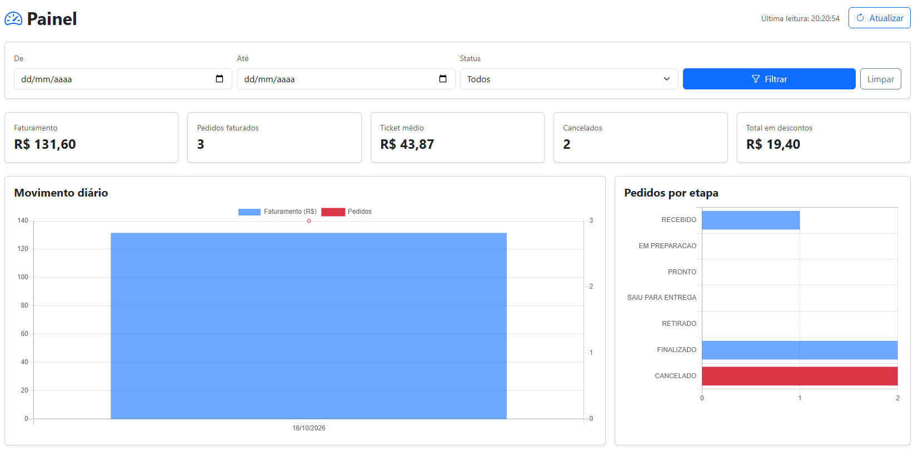
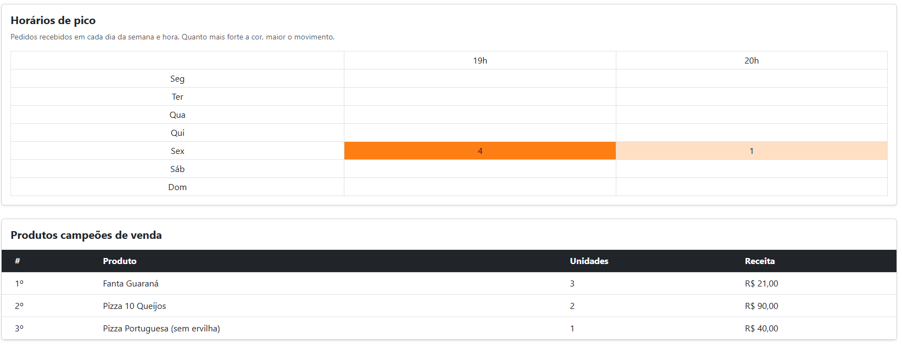

# Painel Administrativo: Pediu Patrão

Painel para o responsável pelo estabelecimento acompanhar vendas, situação dos pedidos e produtos mais vendidos. Os dados vêm de uma API REST (`/api/painel`) que consulta a coleção `pedidos` no MongoDB.

## 1. Requisitos funcionais

| Código | Requisito | Onde foi atendido |
|---|---|---|
| RF01 | Indicadores gerais de vendas: faturamento, pedidos faturados, ticket médio, cancelados e total em descontos | `GET /api/painel/resumo` e cards do painel |
| RF02 | Análise de vendas em gráfico: faturamento e quantidade de pedidos por dia, e horários de pico (dia da semana × hora) | `GET /api/painel/vendas` com gráfico de barras/linha e `GET /api/painel/movimento` com mapa de calor |
| RF03 | Situação dos pedidos: quantidade em cada status do fluxo | `GET /api/painel/status` e gráfico de barras horizontais (cancelados em vermelho) |
| RF04 | Produtos mais vendidos, por unidades e receita | `GET /api/painel/produtos` e tabela de ranking |
| RF05 | Filtros de consulta por período (data inicial e final) e por status | Parâmetros `inicio`, `fim` e `status` em todos os endpoints e formulário de filtros |
| RF06 | Integração do painel com a API | A tela não recebe dados do servidor ao abrir; tudo é buscado por `fetch` nos endpoints |
| RF07 | Atualização e tratamento de dados | Botão "Atualizar", atualização automática a cada 30 s, hora da última leitura, mensagens de erro e de lista vazia |

### Regras de negócio

- Pedido `CANCELADO` não entra no faturamento, no ticket médio, nos descontos, no gráfico de vendas nem no ranking; aparece apenas no indicador de cancelados e na situação dos pedidos.
- Pedidos antigos, criados antes do cálculo de valores, contam com valor zero em vez de quebrar o cálculo.
- A situação dos pedidos sempre devolve os 7 status do fluxo, mesmo os que estão com zero.
- No ranking, empate de unidades é desempatado pela maior receita.
- O período considera o dia final inteiro (até 23:59:59).

## 2. Requisitos não funcionais

| Código | Requisito |
|---|---|
| RNF01 | Segurança: o painel e a API só podem ser acessados por usuários autenticados com perfil `ADMIN` ou `GERENTE` (Spring Security). |
| RNF02 | Respostas da API em JSON; erros sempre no formato `{"erro": "mensagem"}` com o status HTTP adequado. |
| RNF03 | O filtro de período é aplicado na consulta ao MongoDB, não depois de carregar todos os pedidos. |
| RNF04 | Interface seguindo o padrão visual do sistema (Bootstrap 5, Bootstrap Icons) e responsiva. |
| RNF05 | Gráficos com Chart.js, que já fazia parte dos arquivos estáticos do projeto, sem nova dependência. |
| RNF06 | Valores monetários arredondados em centavos na API e exibidos em reais (R$) na tela. |
| RNF07 | Código coberto por testes automatizados (JUnit 5, Mockito e MockMvc). |

## 3. Documentação dos endpoints

Base: `http://localhost:8080/api/painel`. Todos os endpoints são `GET`, exigem sessão autenticada com perfil `ADMIN` ou `GERENTE` e aceitam os filtros abaixo.

### Filtros comuns

| Parâmetro | Tipo | Obrigatório | Descrição |
|---|---|---|---|
| `inicio` | data `aaaa-mm-dd` | não | Primeiro dia do período. Se só `fim` for informado, considera 01/01/1970. |
| `fim` | data `aaaa-mm-dd` | não | Último dia do período (inclusivo). Se só `inicio` for informado, considera hoje. |
| `status` | `RECEBIDO`, `EM_PREPARACAO`, `PRONTO`, `SAIU_PARA_ENTREGA`, `RETIRADO`, `FINALIZADO`, `CANCELADO` | não | Considera somente pedidos nesse status. |

Sem nenhum filtro, todos os pedidos são considerados.

### Erros possíveis

| Status | Quando acontece | Corpo |
|---|---|---|
| 302 | Usuário não autenticado (redireciona para `/login`) | Sem corpo |
| 400 | Data inicial depois da final | `{"erro": "O período informado termina antes de começar."}` |
| 400 | Data em formato inválido (ex.: `07/11/2026`) | `{"erro": "O parâmetro inicio recebeu um valor que não foi reconhecido."}` |
| 400 | Status inexistente (ex.: `ENTREGUE`) | `{"erro": "O parâmetro status recebeu um valor que não foi reconhecido."}` |
| 400 | `limite` não numérico ou menor que 1 (só em `/produtos`) | `{"erro": "O parâmetro limite recebeu um valor que não foi reconhecido."}` / `{"erro": "O ranking precisa de pelo menos 1 posição."}` |
| 403 | Perfil `ATENDENTE` | página de acesso negado |

### GET /api/painel/resumo (RF01)

Indicadores gerais de vendas.

Requisição:

```http
GET /api/painel/resumo?inicio=2026-11-01&fim=2026-11-08
```

Resposta `200`:

```json
{
  "faturamento": 131.6,
  "pedidosFaturados": 3,
  "ticketMedio": 43.87,
  "cancelados": 2,
  "somaDescontos": 19.4
}
```

| Campo | Descrição |
|---|---|
| `faturamento` | Soma do `valorTotal` dos pedidos não cancelados |
| `pedidosFaturados` | Quantidade de pedidos não cancelados |
| `ticketMedio` | `faturamento / pedidosFaturados` (0 quando não há pedidos) |
| `cancelados` | Quantidade de pedidos cancelados |
| `somaDescontos` | Soma do `valorDesconto` dos pedidos não cancelados |

### GET /api/painel/vendas (RF02)

Faturamento e quantidade de pedidos por dia, em ordem cronológica. Dias sem venda não aparecem.

Requisição:

```http
GET /api/painel/vendas?inicio=2026-11-01&fim=2026-11-08
```

Resposta `200`:

```json
[
  { "dia": "2026-11-07", "pedidos": 1, "faturamento": 45.0 },
  { "dia": "2026-11-08", "pedidos": 2, "faturamento": 86.6 }
]
```

### GET /api/painel/status (RF03)

Quantidade de pedidos em cada status, na ordem do fluxo.

Requisição:

```http
GET /api/painel/status
```

Resposta `200`:

```json
{
  "RECEBIDO": 1,
  "EM_PREPARACAO": 0,
  "PRONTO": 1,
  "SAIU_PARA_ENTREGA": 0,
  "RETIRADO": 0,
  "FINALIZADO": 1,
  "CANCELADO": 2
}
```

### GET /api/painel/movimento (RF02)

Quantidade de pedidos recebidos em cada dia da semana (segunda a domingo) e em cada hora do dia (posições 0 a 23 da lista), pela data e hora de entrada. Conta todos os pedidos do recorte, inclusive os cancelados, porque mede a demanda que chegou ao balcão. Serve para planejar a escala da equipe e o horário de funcionamento.

Requisição:

```http
GET /api/painel/movimento?inicio=2026-10-01&fim=2026-11-08
```

Resposta `200` (listas encurtadas):

```json
{
  "MONDAY":   [0, 0, ..., 0, 1, 0, 0],
  "TUESDAY":  [0, 0, ..., 0, 0, 0, 0],
  "WEDNESDAY":[0, 0, ..., 0, 0, 0, 0],
  "THURSDAY": [0, 0, ..., 0, 0, 0, 0],
  "FRIDAY":   [0, 0, ..., 2, 3, 1, 0],
  "SATURDAY": [0, 0, ..., 4, 2, 0, 0],
  "SUNDAY":   [0, 0, ..., 1, 0, 0, 0]
}
```

Na tela, o mapa mostra só as horas que tiveram pedido em algum dia, e a cor de cada célula fica mais forte conforme o movimento se aproxima do maior valor do recorte.

### GET /api/painel/produtos (RF04)

Ranking dos produtos mais vendidos.

| Parâmetro extra | Tipo | Padrão | Descrição |
|---|---|---|---|
| `limite` | inteiro ≥ 1 | 5 | Quantidade de posições do ranking |

Requisição:

```http
GET /api/painel/produtos?limite=3
```

Resposta `200`:

```json
[
  { "produtoId": "6730...a1", "nome": "Fanta Guaraná", "unidades": 3, "receita": 21.0 },
  { "produtoId": "6730...a2", "nome": "Pizza 10 Queijos", "unidades": 2, "receita": 90.0 },
  { "produtoId": "6730...a3", "nome": "Pizza Portuguesa (sem ervilha)", "unidades": 1, "receita": 40.0 }
]
```

Exemplo de erro (`400`):

```http
GET /api/painel/produtos?limite=0
```

```json
{ "erro": "O ranking precisa de pelo menos 1 posição." }
```

## 4. Decisões de análise e projeto

- **Sem nova coleção:** os indicadores são calculados a partir dos pedidos que já guardam itens, valores, status e data de entrada. Isso evita dados duplicados que poderiam ficar desatualizados.
- **Um endpoint por recurso do painel:** cada bloco da tela tem seu endpoint, o que permite reaproveitar a API em outros clientes e testar cada cálculo separadamente.
- **Filtro único (`FiltroPainel`):** os mesmos parâmetros valem para todos os endpoints e passam por um único método do `PainelService`, garantindo que cards, gráficos e ranking mostrem sempre o mesmo recorte.
- **Período no banco:** o `PedidoRepository` usa a consulta derivada `findByDataHoraEntradaBetween` com um `Range` fechado no início e aberto no fim (`Range.rightOpen`), trazendo só os pedidos do período sem escrever a query à mão.
- **Horários de pico:** além do que a atividade pede, o painel cruza dia da semana e hora de entrada dos pedidos. Para uma pizzaria, saber que sexta às 20h concentra o movimento ajuda mais na decisão (equipe, estoque, promoções em horários fracos) do que apenas o total do dia.
- **Acesso:** `ADMIN` e `GERENTE` são os perfis de gestão; o `ATENDENTE` opera os pedidos mas não vê os números do negócio.

### Modelo de dados utilizado

O painel não cria coleções novas: lê a coleção `pedidos` do MongoDB (documento `Pedido`, com a lista embutida `ItemPedido`).

| Campo | Usado em |
|---|---|
| `Pedido.status` | Separar cancelados, situação dos pedidos e filtro por status |
| `Pedido.valorTotal` | Faturamento, ticket médio e vendas por dia |
| `Pedido.valorDesconto` | Total em descontos |
| `Pedido.dataHoraEntrada` | Filtro de período, vendas por dia e horários de pico |
| `Pedido.itens` (`produtoId`, `nomeProduto`, `quantidade`, `subtotal`) | Ranking de produtos |

### Estrutura

| Camada | Arquivo |
|---|---|
| Controller REST | `controller/PainelController.java` |
| Regras e cálculos | `service/PainelService.java` |
| Consulta ao banco | `repository/PedidoRepository.java` (`findByDataHoraEntradaBetween`) |
| DTOs | `dto/FiltroPainel`, `dto/IndicadoresVenda`, `dto/VendaDoDia`, `dto/ProdutoNoRanking` |
| Tratamento de erros | `controller/TratamentoErrosApi.java` |
| Tela | `templates/painel.html` (rota `/painel`) |

## 5. Evidências de testes

### Telas do painel

Parte superior: filtros, indicadores gerais (RF01), movimento diário (RF02) e pedidos por etapa (RF03).



Parte inferior: horários de pico (RF02) e produtos campeões de venda (RF04).



### Testes automatizados

Executados com `mvnw test`: **98 testes, 0 falhas, 0 erros**.

`PainelServiceTest` (unitários, Mockito):

| Teste | O que verifica |
|---|---|
| `indicadoresIgnoramPedidosCanceladosNoFaturamento` | Faturamento, ticket médio e descontos sem os cancelados |
| `semPedidosOsIndicadoresFicamZerados` | Base vazia não gera erro nem divisão por zero |
| `pedidoAntigoSemValoresContaComoZero` | Pedidos sem `valorTotal`/`valorDesconto` |
| `vendasSaoSomadasPorDiaEmOrdemCronologica` | Agrupamento por dia, ordem e exclusão de cancelados |
| `contagemPorStatusTrazTodosOsStatusMesmoSemPedido` | Os 7 status sempre presentes |
| `rankingSomaUnidadesDosPedidosValidosEOrdenaDoMaiorParaOMenor` | Soma por produto, ordem e limite |
| `rankingNaoAceitaLimiteZero` | Validação do limite |
| `periodoConsultaOBancoDoInicioDoPrimeiroDiaAteOFimDoUltimo` | Limites da consulta por período |
| `filtroDeStatusMantemSomenteOsPedidosDaqueleStatus` | Filtro por status |
| `dataInicialDepoisDaFinalEhRecusada` | Período invertido não chega ao banco |
| `movimentoContaPedidosPorDiaDaSemanaEHoraDeEntrada` | Contagem do mapa de calor por dia da semana e hora |

`AutorizacaoIntegrationTest` (integração, MockMvc + Spring Security):

| Teste | O que verifica |
|---|---|
| `painelDeVendasEhRestritoAAdminEGerente` | `403` para atendente e `200` para admin/gerente em todos os endpoints e na tela |
| `filtrosInvalidosDoPainelRespondemBadRequest` | `400` com mensagem para período invertido, data, status e limite inválidos |
| `menuMostraSomenteTelasPermitidasAoPerfil` | Item do menu exibido conforme o perfil |

### Teste manual

Com a aplicação rodando e o MongoDB local, logado como `gerente`:

1. `/painel` carregou os cards com faturamento de R$ 131,60, 3 pedidos faturados, ticket médio de R$ 43,87, 2 cancelados e R$ 19,40 de descontos, além do ranking com Fanta Guaraná em 1º (3 unidades).
2. Com "De" = 07/11/2026 e "Até" = 01/11/2026, o painel exibiu o alerta "O período informado termina antes de começar.".
3. Ao limpar os filtros, o alerta sumiu e os dados voltaram a ser exibidos.

O acesso negado ao `ATENDENTE` e o menu por perfil são verificados pelos testes de integração da seção anterior.

## 6. Vídeo de apresentação

Demonstração do painel funcionando e justificativa das principais decisões de análise e projeto (cerca de 2 minutos): [video/PediuPatrao-VideoDash.mp4](video/PediuPatrao-VideoDash.mp4).

## 7. Como executar

1. Iniciar o MongoDB em `mongodb://127.0.0.1:27017`.
2. Rodar a aplicação: `mvnw spring-boot:run`.
3. Acessar `http://localhost:8080/login` com o usuário `gerente` ou `admin` e abrir o menu **Painel**.
4. Rodar os testes: `mvnw test`.
